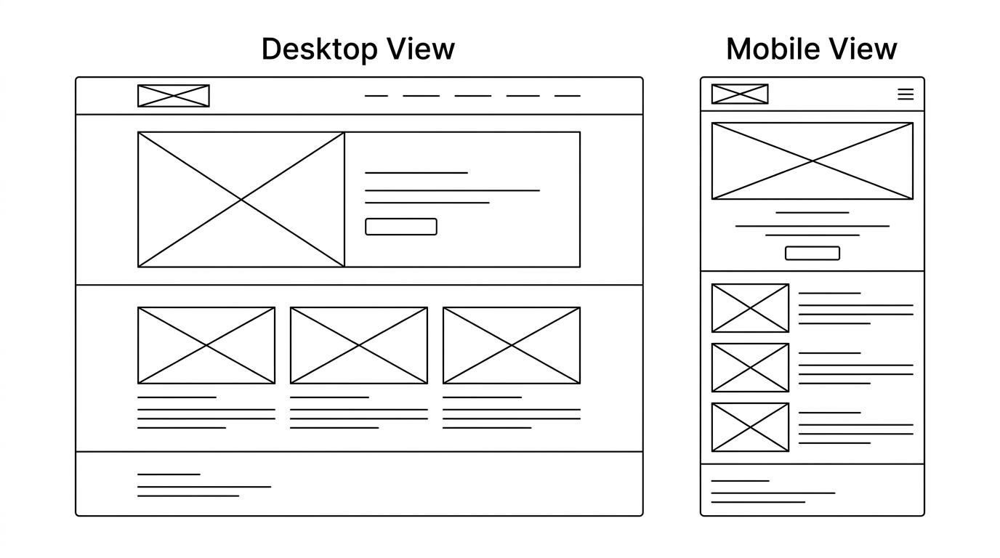

Bản phác thảo  trên minh họa cấu trúc bố cục đáp ứng (responsive layout) cho trang web cá nhân của tôi với hai chế độ xem riêng biệt: màn hình máy tính (Desktop View) và thiết bị di động (Mobile View). Thiết kế sử dụng các khối đen trắng cơ bản để tập trung vào cấu trúc thông tin thay vì màu sắc hay phông chữ.

Chế độ xem màn hình lớn (Desktop View): Thanh điều hướng hiển thị đầy đủ các liên kết theo chiều ngang ở trên cùng. Ngay bên dưới là khu vực giới thiệu chính (Hero section) và phần nội dung nổi bật được chia thành lưới 3 cột ngang bằng nhau giúp tận dụng không gian rộng của màn hình.

Chế độ xem di động (Mobile View): Để tối ưu trải nghiệm trên màn hình nhỏ, thanh điều hướng được thu gọn thành biểu tượng menu (hamburger icon). Các khối nội dung nổi bật chuyển từ bố cục 3 cột ngang sang xếp chồng theo chiều dọc (1 cột) giúp người dùng dễ dàng cuộn đọc và thao tác chạm. 
